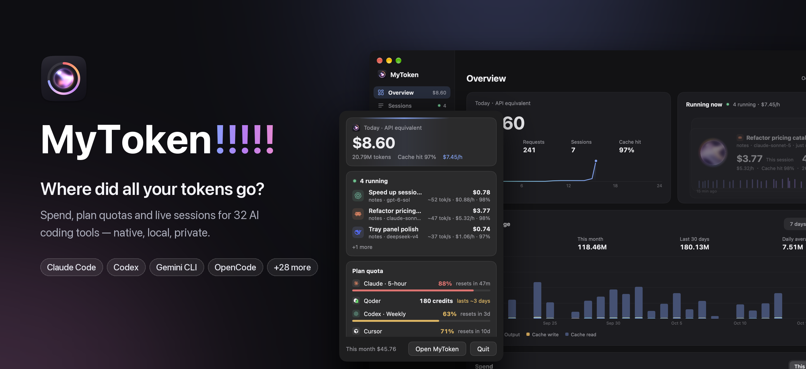
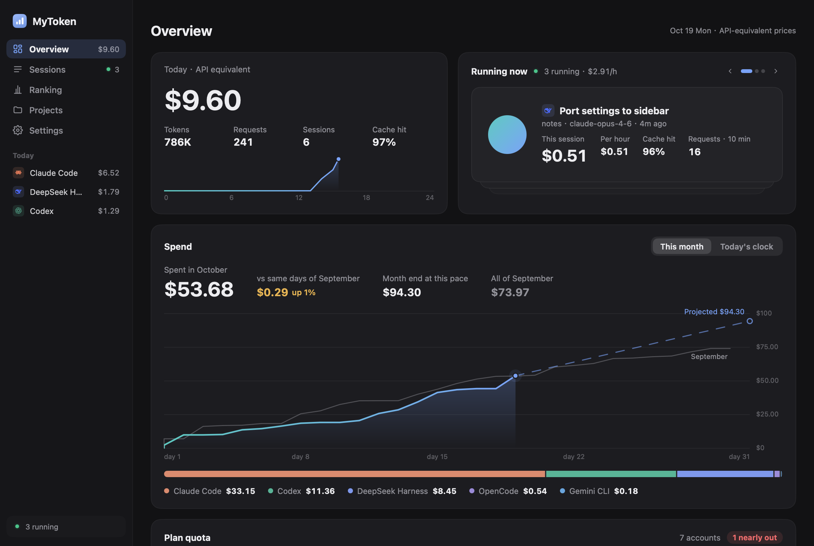
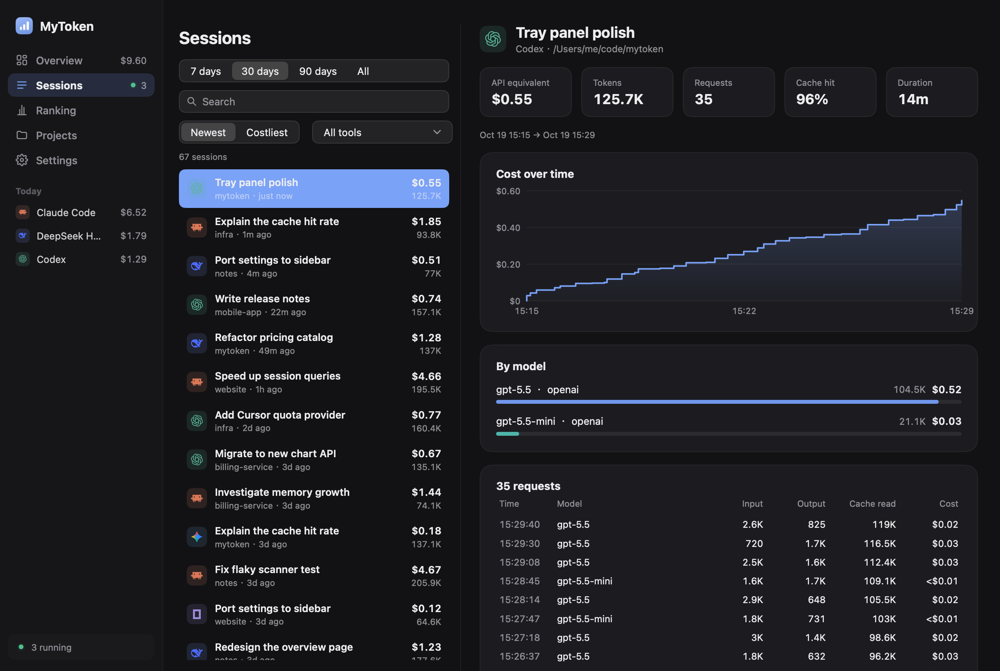
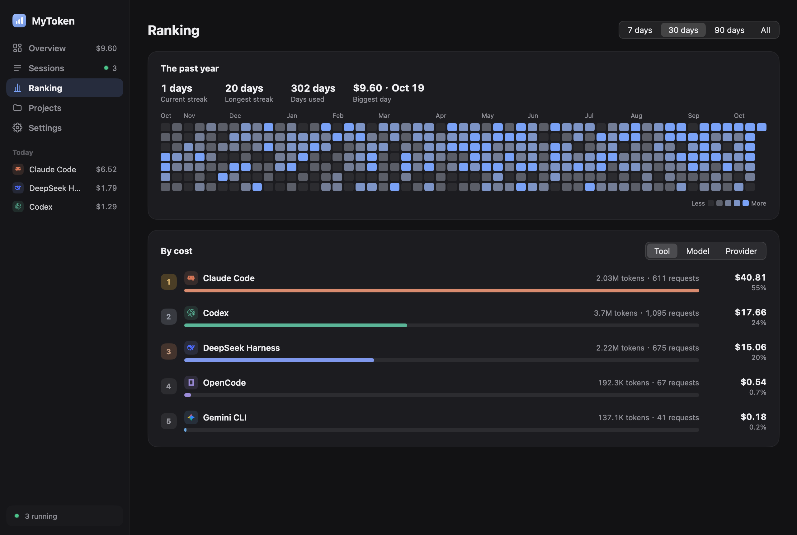
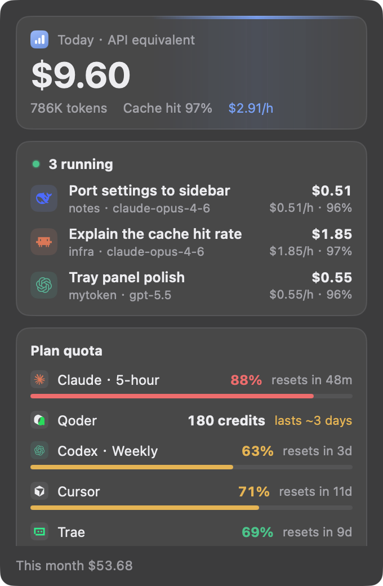
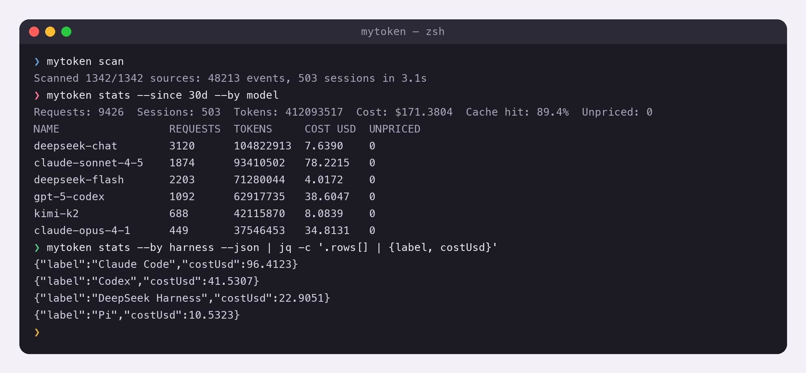
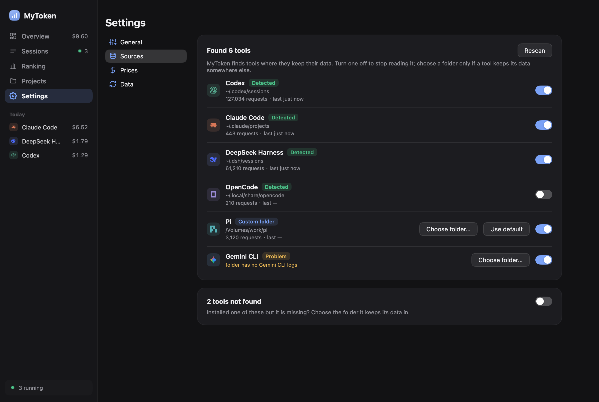

<p align="center">
  
</p>

<h1 align="center">MyToken!!!!!</h1>

<p align="center">
  <a href="https://github.com/zzstar101/mytoken/releases/latest"></a>
  <a href="https://github.com/zzstar101/mytoken/actions/workflows/ci.yml"></a>
  <a href="https://github.com/zzstar101/mytoken/releases"></a>
  
  <a href="go.mod"></a>
  <a href="LICENSE"></a>
  <a href="https://github.com/egoist/mygo"></a>
</p>

<p align="center"><b>⚡ Powered by <a href="https://github.com/egoist/mygo">MyGo</a>!</b></p>

<p align="center"><b>English</b> · <a href="README.zh-CN.md">简体中文</a></p>
<p align="center"><a href="#install">Install</a> · <a href="#screenshots">Screenshots</a> · <a href="#supported-harnesses">Harnesses</a> · <a href="docs/CLI.md">CLI</a> · <a href="docs/ROADMAP.md">Roadmap</a> · <a href="https://github.com/zzstar101/mytoken/releases/latest">Download</a></p>

**What did your AI coding cost today, and how much plan quota is left?** MyToken!!!!! reads the
session logs your AI coding tools already write to disk, prices every request at the official API
list price, and shows today's and this month's spend, your Codex / Claude / Cursor plan quotas and
what is running right now — in a native desktop app, a menu-bar panel, or the command line.

Everything happens on your machine. No account, no telemetry, no uploads: by default the app
makes the price table download and a daily update check on github.com; plan quotas are fetched
from a tool's own service only with the credentials that tool already stored. Nothing else is
contacted.

- **Thirty-two harnesses in one window** — Claude Code, Codex CLI, DSH, pi, Gemini CLI, opencode,
  Crush, Cline, Roo Code, Kilo Code, Claude Desktop, WorkBuddy, CodeBuddy, Hermes, Qwen Code, Kimi,
  OpenClaude, Grok, OpenClaw, Droid, Goose, Forge, Amp, Kiro, Zed, Antigravity, Codebuff, Mux,
  ZCode, MiniMax Code, MiMo Code and Step Code.
- **Session × provider × model** — token classes kept apart (input, output, cache read, cache write,
  reasoning), with cache-hit rate, per-project and per-day breakdowns, and sub-agent trees.
- **API-equivalent cost** — models.dev prices with a LiteLLM fallback, labelled as what the same
  tokens would cost at list price. Add your own per-model prices when a plan or gateway differs;
  there are no provider multipliers or inferred discounts.
- **Spend first** — today's cost in big type, the month so far with a forecast, daily spend stacked
  by tool, and rankings by cost. Token counts leave cache reads out of the headline number.
- **Plan quotas** — Codex, Claude, Cursor, Copilot and GLM windows as rings, with reset times,
  detected automatically.
- **Menu bar** — today's spend (or spend per hour, cache hit rate, quota) beside the icon; the panel
  lists sessions running now with their cost, $/hour and cache hit rate, and every quota.
- **CLI for scripts** — `mytoken` prints today's and this month's cost; `mytoken daily` prints a
  ccusage-style table with each cache class in its own column.
- **Native, small, fast** — built with [MyGo](https://github.com/egoist/mygo)'s native UI package:
  no Electron, no WebView, no cgo. A full first scan of this machine's logs takes seconds.

## Screenshots

| Overview | Sessions |
| --- | --- |
|  |  |

| Ranking | Menu bar panel |
| --- | --- |
|  |  |

| CLI | Settings |
| --- | --- |
|  |  |

## Supported harnesses

MyToken!!!!! reads the logs each harness already keeps. Nothing is written back to them: the
readers are read-only and store only numbers plus a session title (the first 60 characters of the
first user message).

| Harness | ID | Where the logs live |
| --- | --- | --- |
| Claude Code | `claude-code` | `~/.claude/projects/**/*.jsonl` (`$CLAUDE_CONFIG_DIR/projects`), plus `~/.config/claude/projects` when it exists |
| Codex CLI | `codex` | `$CODEX_HOME/sessions` and `$CODEX_HOME/archived_sessions` (`~/.codex` by default) |
| DSH — DeepSeek Harness | `dsh` | `$DSH_HOME/sessions` (`~/.dsh/sessions` by default) |
| pi / OMP / OMO-senpi | `pi` | `$PI_HOME/sessions` when set; otherwise `~/.pi/agent/sessions` plus detected OMP and OMO/senpi agent roots |
| Gemini CLI | `gemini` | `$GEMINI_CLI_HOME/tmp` (`~/.gemini/tmp` by default) |
| opencode | `opencode` | `$OPENCODE_DATA_HOME`, else `$XDG_DATA_HOME/opencode`, else `~/.local/share/opencode` |
| Crush | `crush` | `$CRUSH_GLOBAL_DATA`, else `$XDG_DATA_HOME/crush`, else `~/.local/share/crush` |
| Cline | `cline` | `…/globalStorage/saoudrizwan.claude-dev/tasks`, plus `~/.cline/data/tasks` and `~/.cline/data/sessions` |
| Roo Code | `roo` | `…/globalStorage/rooveterinaryinc.roo-cline/tasks` |
| Kilo Code | `kilo` | `…/globalStorage/kilocode.kilo-code/tasks` |
| Claude Desktop | `claude-desktop` | `…/Claude/local-agent-mode-sessions` and its `Claude-3p` sibling (macOS: `~/Library/Application Support`, Windows: `%APPDATA%`), plus the Cowork usage ledger |
| WorkBuddy | `workbuddy` | `$WORKBUDDY_HOME/projects` (`~/.workbuddy/projects` by default) |
| CodeBuddy | `codebuddy` | `$CODEBUDDY_HOME/projects` (`~/.codebuddy/projects` by default) |
| Hermes | `hermes` | `$HERMES_HOME` (`~/.hermes` by default), SQLite |
| Qwen Code | `qwen` | `$QWEN_DATA_DIR/projects` (`~/.qwen/projects` by default) |
| Kimi / Kimi Code | `kimi` | Legacy `$KIMI_SHARE_DIR/sessions` (`~/.kimi/sessions`) plus `$KIMI_CODE_HOME/sessions` (`~/.kimi-code/sessions`) |
| OpenClaude | `openclaude` | `$CODEBURN_OPENCLAUDE_DIR/projects`, else `~/.openclaude/projects` |
| Grok | `grok` | `$GROK_HOME` (`~/.grok` by default) |
| OpenClaw | `openclaw` | `~/.openclaw/agents`, plus the `~/.moltbot`, `~/.moldbot` and `~/.clawdbot` spellings |
| Droid | `droid` | `$FACTORY_DIR` (`~/.factory` by default) |
| Goose | `goose` | `$GOOSE_PATH_ROOT/…`, else `~/.local/share/goose/sessions` (Windows: `%APPDATA%\Block\goose\sessions`), SQLite |
| Forge | `forge` | `~/.forge` by default, SQLite |
| Amp | `amp` | `$AMP_DATA_DIR` (comma-separated), else `~/.local/share/amp` |
| Kiro | `kiro` | `$KIRO_HOME` (`~/.kiro` by default), plus the platform Kiro `globalStorage` agent directory |
| Zed | `zed` | `…/Zed/threads/threads.db` (macOS: `~/Library/Application Support`, Windows: `%LOCALAPPDATA%`, Linux: `~/.local/share/zed`), SQLite |
| Antigravity | `antigravity` | `$GEMINI_CLI_HOME/antigravity{,-cli,-ide}/conversations` and the matching `implicit` dirs (`~/.gemini` by default), only `*.db` |
| Codebuff | `codebuff` | `$CODEBUFF_DATA_DIR`, else `~/.config/manicode`, `~/.config/manicode-dev` and `~/.config/manicode-staging` |
| Mux | `mux` | `$CODEBURN_MUX_DIR` or `$MUX_ROOT`, else `~/.mux`, `~/.mux-dev` and `~/.cmux` |
| ZCode | `zcode` | `$MYTOKEN_ZCODE_DIRS`, else `~/.zcode/cli/db/db.sqlite`, query-only SQLite |
| MiniMax Code | `minimax-code` | `$MINIMAX_DATA_DIR` / `$MAVIS_DATA_DIR`, else `~/.minimax/v2/sqlite/runtime-state.sqlite` (legacy `~/.mavis`) |
| MiMo Code | `mimo-code` | `$MIMOCODE_HOME/data`; otherwise `$XDG_DATA_HOME/mimocode` or `~/.local/share/mimocode` on every OS (matching upstream `xdg-basedir`), query-only SQLite |
| Step Code | `step-code` | `$STEP_CODING_AGENT_SESSION_DIR`, `$STEP_CODING_AGENT_DIR/sessions`, else `~/.stepcode/agent/sessions` |

ZCode, MiniMax Code, MiMo Code and Step Code are protocol-validated against upstream source and
synthetic conformance fixtures; Kimi Code and the OMP/OMO compatibility paths have the same evidence
level. No anonymized real-install fixture was available for this batch, so they remain explicitly
unverified against real-world logs. See [`docs/harness-verification/v04x-harness-matrix.md`](docs/harness-verification/v04x-harness-matrix.md).

Amp, Kiro, Zed, Antigravity, Codebuff, Mux, Hermes and OpenClaw likewise have conformance coverage but
no committed anonymized real-world fixture yet.

For the VS Code family extensions, `…/globalStorage` is resolved per platform and per editor —
editors: VS Code, VS Code Insiders, Cursor, Windsurf, VSCodium, Trae; platforms:
`~/Library/Application Support/<editor>/User/globalStorage` on macOS,
`~/.config/<editor>/User/globalStorage` (or `$XDG_CONFIG_HOME/…`) on Linux, and
`%APPDATA%\<editor>\User\globalStorage` on Windows.

Every reader can be pointed somewhere else, which is handy for non-default installs, containers and
archived logs:

| Variable | Effect |
| --- | --- |
| `MYTOKEN_HOME` | Where the index lives (all platforms) |
| `CLAUDE_CONFIG_DIR` | Claude Code config dir instead of `~/.claude` |
| `CODEX_HOME` | Codex data dir instead of `~/.codex` |
| `DSH_HOME` | DSH data dir instead of `~/.dsh` |
| `PI_HOME`, `MYTOKEN_PI_DIRS` | pi data dir, or explicit pi-compatible session roots (path list) |
| `PI_CODING_AGENT_DIR`, `OMP_PROFILE`, `PI_PROFILE`, `PI_CONFIG_DIR` | OMP agent/profile roots reused by the `pi` reader |
| `OMO_CODING_AGENT_DIR`, `SENPI_CODING_AGENT_DIR` | OMO/senpi agent roots reused by the `pi` reader |
| `GEMINI_CLI_HOME` | Gemini CLI data dir instead of `~/.gemini` |
| `MYTOKEN_GEMINI_DIRS` | Explicit Gemini CLI log dirs (path list) |
| `OPENCODE_DATA_HOME` | opencode data dir |
| `MYTOKEN_OPENCODE_DIRS` | Explicit opencode dirs (path list) |
| `CRUSH_GLOBAL_DATA` | Crush data dir |
| `MYTOKEN_CRUSH_DIRS` | Explicit Crush dirs (path list) |
| `CLINE_DIR`, `CLINE_DATA_DIR`, `CLINE_SESSION_DATA_DIR` | Cline data dirs |
| `MYTOKEN_CLINE_DIRS`, `MYTOKEN_ROO_DIRS`, `MYTOKEN_KILO_DIRS` | Explicit Cline / Roo / Kilo dirs (path list) |
| `MYTOKEN_CLAUDEDESKTOP_DIRS` | Explicit Claude Desktop session dirs (path list) |
| `WORKBUDDY_HOME`, `CODEBUDDY_HOME` | WorkBuddy / CodeBuddy home dir instead of `~/.workbuddy` / `~/.codebuddy` |
| `HERMES_HOME` | Hermes home dir instead of `~/.hermes` |
| `QWEN_DATA_DIR`, `MYTOKEN_QWEN_DIRS` | Qwen Code data dir, or explicit dirs (path list) |
| `KIMI_SHARE_DIR`, `KIMI_CODE_HOME`, `MYTOKEN_KIMI_DIRS` | Kimi / Kimi Code data dirs, or explicit dirs (path list) |
| `CODEBURN_OPENCLAUDE_DIR`, `MYTOKEN_OPENCLAUDE_DIRS` | OpenClaude data dir, or explicit dirs (path list) |
| `GROK_HOME`, `MYTOKEN_GROK_DIRS` | Grok home dir, or explicit dirs (path list) |
| `MYTOKEN_OPENCLAW_DIRS` | Explicit OpenClaw agent dirs (path list) |
| `FACTORY_DIR`, `MYTOKEN_DROID_DIRS` | Droid home dir, or explicit dirs (path list) |
| `GOOSE_PATH_ROOT`, `MYTOKEN_GOOSE_DIRS` | Goose data root, or explicit dirs (path list) |
| `MYTOKEN_FORGE_DIRS` | Explicit Forge dirs (path list) |
| `AMP_DATA_DIR`, `MYTOKEN_AMP_DIRS` | Amp data dirs (comma-separated), or explicit dirs (path list) |
| `KIRO_HOME`, `MYTOKEN_KIRO_DIRS` | Kiro home dir, or explicit dirs (path list) |
| `MYTOKEN_ZED_DIRS` | Explicit Zed threads dirs (path list) |
| `MYTOKEN_ANTIGRAVITY_DIRS` | Explicit Antigravity conversation dirs (path list) |
| `CODEBUFF_DATA_DIR`, `MYTOKEN_CODEBUFF_DIRS` | Codebuff data dir, or explicit dirs (path list) |
| `CODEBURN_MUX_DIR`, `MUX_ROOT`, `MYTOKEN_MUX_DIRS` | Mux data dir, or explicit dirs (path list) |
| `MYTOKEN_ZCODE_DIRS` | Explicit ZCode database files or containing dirs (path list) |
| `MINIMAX_DATA_DIR`, `MAVIS_DATA_DIR`, `MYTOKEN_MINIMAX_DIRS` | MiniMax Code data root, legacy data root, or explicit roots (path list) |
| `MIMOCODE_HOME`, `MIMOCODE_DB`, `MYTOKEN_MIMO_CODE_DIRS` | MiMo Code data root, exact database, or explicit roots (path list) |
| `STEP_CODING_AGENT_SESSION_DIR`, `STEP_CODING_AGENT_DIR`, `MYTOKEN_STEP_CODE_DIRS` | Step Code session root, agent root, or explicit roots (path list) |

## Provider attribution

A log rarely says which account or gateway served a request, so the provider is resolved by a
priority chain, and the app tells you which step produced the answer:

1. **`log`** — the harness recorded the provider itself.
2. **`cc-switch`** — matched against the read-only `~/.cc-switch/cc-switch.db` request log
   (same app type, model and tokens, within ±120 s).
3. **`config-timeline`** — the base URL in `~/.claude/settings.json` or `~/.codex/config.toml` at
   the time of the request, tracked as a timeline.
4. **`inferred`** — deduced from the model name (`claude-*` → Anthropic, `gpt-*`/`o*` → OpenAI,
   `gemini-*` → Google, `deepseek-*` → DeepSeek, …). Shown as inferred, never as fact.
5. **`user-rule`** — your own rules win over everything above.

## Pricing

- Prices come from [models.dev](https://models.dev), with LiteLLM's
  [`model_prices_and_context_window.json`](https://github.com/BerriAI/litellm) as the fallback and a
  bundled offline snapshot for the first run. The table is cached on disk for 24 hours and the app
  works entirely offline with the cached copy.
- Each of the five token classes is priced separately; reasoning tokens fall back to the output
  rate when the table has no reasoning price.
- **Custom prices.** When a plan, gateway or negotiated rate differs from the list price, set USD
  prices per million tokens (input, output, cache read, cache write) for a model. Prices are
  list-price equivalents: MyToken never applies a provider multiplier or guesses a discount.
- 1-hour cache writes are priced at twice the input rate and the remaining cache writes at 1.25×
  input, unless the catalog carries explicit cache-write prices.
- **Model mappings.** Model names your own config invented have no price in any table, so
  they are listed as *unpriced* instead of guessed at. Map each one to the real model — and
  optionally to a provider — and those requests are priced and
  merged into the rankings from then on (*Settings → Prices*).
- A cost recorded in the log itself always wins over the computed one, and requests that no price
  can be found for are reported as *unpriced* instead of silently costing nothing.

## Privacy

- **Local only.** The index, the price cache and the settings never leave your machine. There is no
  telemetry, no analytics, no crash reporting, no account and no sync.
- **Two requests by default — the price table and the update check.** The price table comes from
  models.dev, falling back to LiteLLM; with a cached or bundled table no request is made. Once a day
  the app asks github.com whether there is a new version, sending nothing but the request itself;
  builds that cannot update themselves (development builds, the Debian package) never ask. The command line never checks. Plan-quota providers contact their own service
  only when a credential for that tool already exists on disk; there is no separate consent step and
  no credential is copied into the index.
- **Read-only readers.** Harness logs are opened for reading; the index is a separate SQLite file
  that you can delete at any time to start over.
- **No conversation content.** Only numbers and metadata are stored. The single exception is the
  session title: the first 60 characters of the first user message, so the session list is readable.

| Platform | Index directory |
| --- | --- |
| macOS | `~/Library/Application Support/MyToken` |
| Windows | `%APPDATA%\MyToken` |
| Linux | `$XDG_DATA_HOME/mytoken` (usually `~/.local/share/mytoken`) |

The database is `mytoken.db` inside it. Set `MYTOKEN_HOME` to keep it elsewhere (handy for trying
the app against a scratch index); delete the directory to reset.

## Install

### macOS (disk image)

Download `mytoken-<version>-darwin-universal.dmg` from [Releases](../../releases), open it and drag **MyToken!!!!!**
into *Applications*. The bundle is ad-hoc signed rather than notarized, so the first launch needs
right-click → *Open* (or `xattr -dr com.apple.quarantine /Applications/mytoken.app`). The app's file
name is `mytoken.app`; Finder and the menu bar show `MyToken!!!!!`.

### Windows (installer)

Download `mytoken-<version>-windows-amd64-setup.exe` (or `-arm64-`) and run it. The installer is unsigned, so SmartScreen asks
for *More info* → *Run anyway* the first time. It installs `mytoken.exe`, a Start Menu entry and the
uninstaller.

### Linux (install script)

```sh
v=0.3.0 arch=amd64   # or arm64
curl -fLO https://github.com/zzstar101/mytoken/releases/download/v$v/mytoken-$v-linux-$arch.tar.gz
curl -fLO https://github.com/zzstar101/mytoken/releases/download/v$v/install.sh
sh install.sh mytoken-$v-linux-$arch.tar.gz
```

Installs per user, without root: the app in `~/.local/mytoken.app`, the `mytoken` command in
`~/.local/bin` and an entry in the applications menu. `sh install.sh --uninstall` removes it and
keeps your data.

### Linux (Debian package)

```sh
sudo apt install ./mytoken_<version>_amd64.deb
```

Installs `/opt/mytoken`, the `/usr/bin/mytoken` command and a desktop entry. It depends on GTK 3,
WebKitGTK 4.1 and libayatana-appindicator3 (the tray icon).

### With the Go toolchain

```sh
go install github.com/zzstar101/mytoken@latest
```

Builds the same binary the bundles carry, including the CLI, into `$(go env GOPATH)/bin/mytoken`.

## Command line

The app binary is also the CLI. A bare `mytoken` in a terminal prints the read-only cost summary;
opened from Finder, Explorer or a launcher it is the app, which also starts with `mytoken gui` (the
login item uses `--hidden`). The full reference is in
[docs/CLI.md](docs/CLI.md).

```sh
mytoken                                        # today and this month, API-equivalent cost
mytoken daily                                  # one row per day, last 30 days
mytoken daily --days 7 --json                  # scripting
mytoken quota                                  # plan quota from local logs and logged-in tools
mytoken scan                                   # re-index now
mytoken statusline                             # one-line status for a shell prompt
mytoken doctor                                 # check index, sources and schema, read-only
mytoken version
```

`summary`, `daily`, `quota`, `statusline` and `doctor` open the index read-only: they never migrate,
reprice or write to it. `daily` puts input, output, cache read and cache write in separate columns
and labels the cost column as API-equivalent. Run `mytoken scan` once after an upgrade to migrate and
reprice the index. `mytoken help` lists every command, and each flag is documented in
[docs/CLI.md](docs/CLI.md).

## Building from source

Requirements: Go 1.27 or newer, and no cgo (`CGO_ENABLED=0` — the SQLite driver is pure Go).
Running the app needs macOS 12+, Windows 10+ or a Linux desktop with GTK 3 and WebKitGTK 4.1.

```sh
git clone https://github.com/zzstar101/mytoken
cd mytoken

make build     # ./mytoken, version taken from the latest v* tag
make run       # run the app from source
make check     # gofmt check, go vet, go test
```

`make help` lists the packaging targets:

```sh
make app       # this platform
make dmg       # universal macOS .app and .dmg
make linux     # linux/amd64 + linux/arm64: binaries, .deb, tarballs, install.sh
make windows   # windows/amd64 + windows/arm64 (.exe and installer; needs makensis)
```

These wrap `go tool mygo build -platform …`. [MyGo](https://github.com/egoist/mygo) is pinned in
`go.mod`'s `tool` directive, so there is nothing to install globally, and its bundle metadata lives
in [mygo.json](mygo.json) — identifier, icon, macOS display name, Linux desktop entry. Note that
MyGo names the bundle and executable after `name` (`mytoken`), which keeps the CLI command and the
artifact file names shell-friendly; the macOS display name is set back to `MyToken!!!!!` through
`CFBundleDisplayName`.

## Releasing

Releases are cut from tags:

```sh
make bump TAG=v0.2.0   # writes the version into mygo.json (or edit it by hand)
git commit -am "release v0.2.0"
git tag v0.2.0
git push origin main --tags
```

[.github/workflows/release.yml](.github/workflows/release.yml) then creates a draft release and
builds the macOS universal bundle, the Windows installers and the Linux packages, attaching them to
that draft; review it and publish. The version always comes from the tag, and no secrets are
required: macOS bundles are ad-hoc signed and Windows installers unsigned. Signing and notarization
secrets are documented at the top of the workflow.

[.github/workflows/ci.yml](.github/workflows/ci.yml) runs `go vet` and `go test` on macOS, Linux and
Windows, plus a `gofmt` check, for every push and pull request.

## Credits

- **[tokscale](https://github.com/junhoyeo/tokscale)** — several harness readers follow tokscale's
  documented parsing rules (for example Gemini CLI's token folding and accepted field names); no
  code was copied.
- **[codeburn](https://github.com/getagentseal/codeburn)** — the qwen, kimi, openclaude,
  claude-desktop, grok, openclaw, droid, goose and forge readers were written from its provider
  readers (see [THIRD_PARTY_NOTICES](THIRD_PARTY_NOTICES)).
- **[MyGo](https://github.com/egoist/mygo)** — the native UI toolkit the app is built with. Powered by MyGo!
- **[models.dev](https://models.dev)** and **[LiteLLM](https://github.com/BerriAI/litellm)** — the
  price tables.
- **[cc-switch](https://github.com/farion1231/cc-switch)** — the pricing import format and the provider request log used by attribution.

## Disclaimer

MyToken!!!!! is an unofficial fan tribute to the band **MyGO!!!!!** — the name, the colour palette
and the little decorations in the UI are affectionate nods, nothing more. This project is not
affiliated with, endorsed by or connected to the band, its members or their labels, and it ships no
official artwork. All trademarks belong to their respective owners.

## License

[MIT](LICENSE) © 2026 zzstar101
