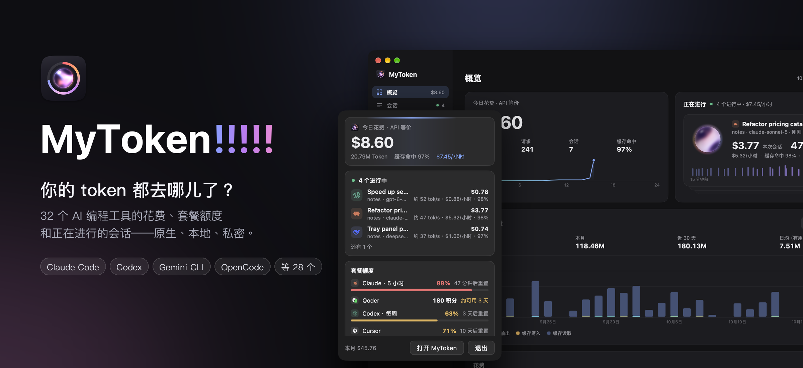
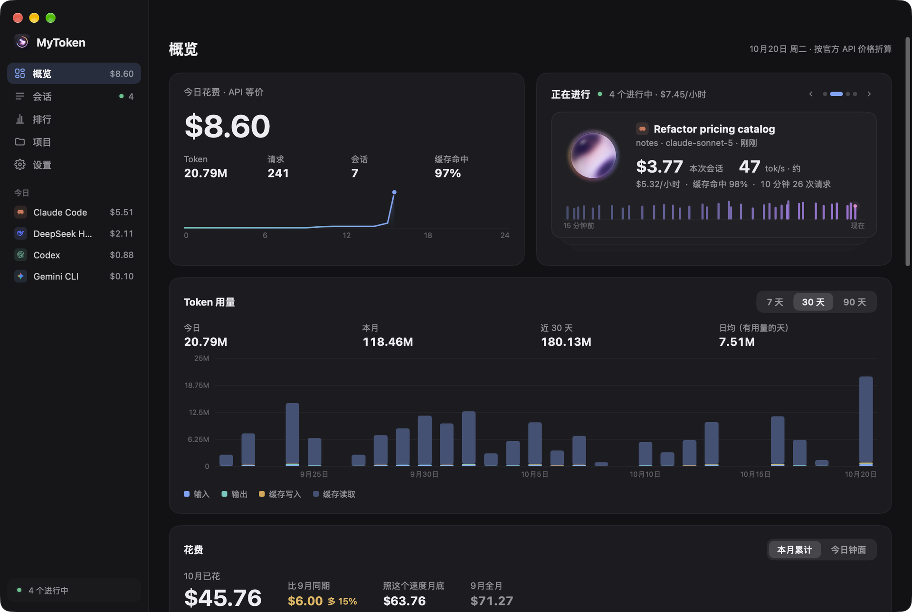
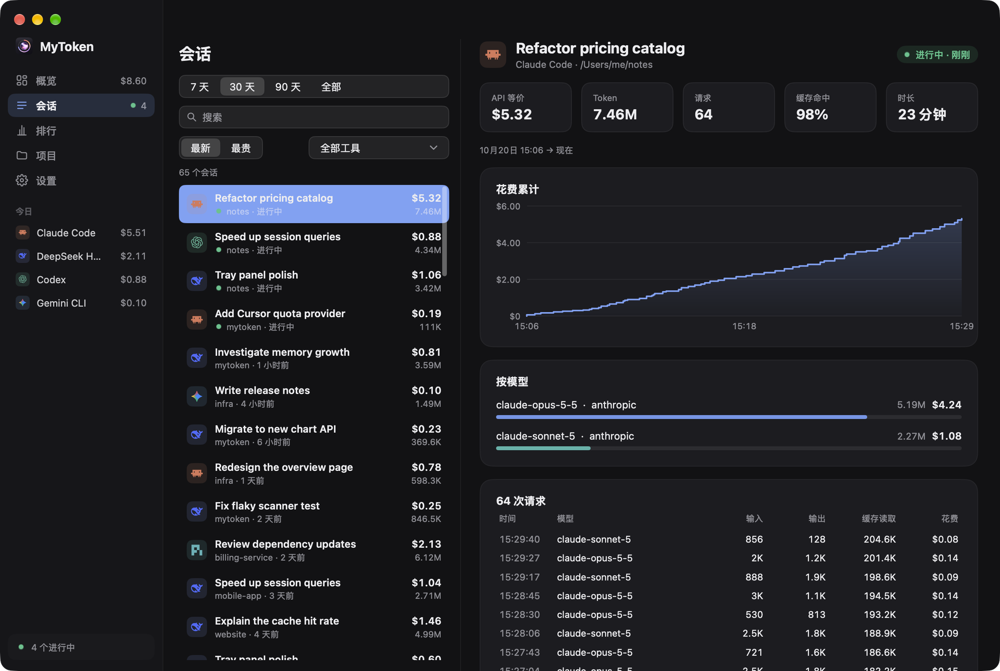
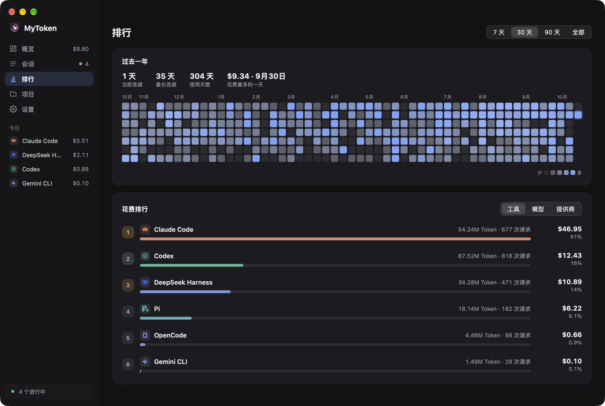
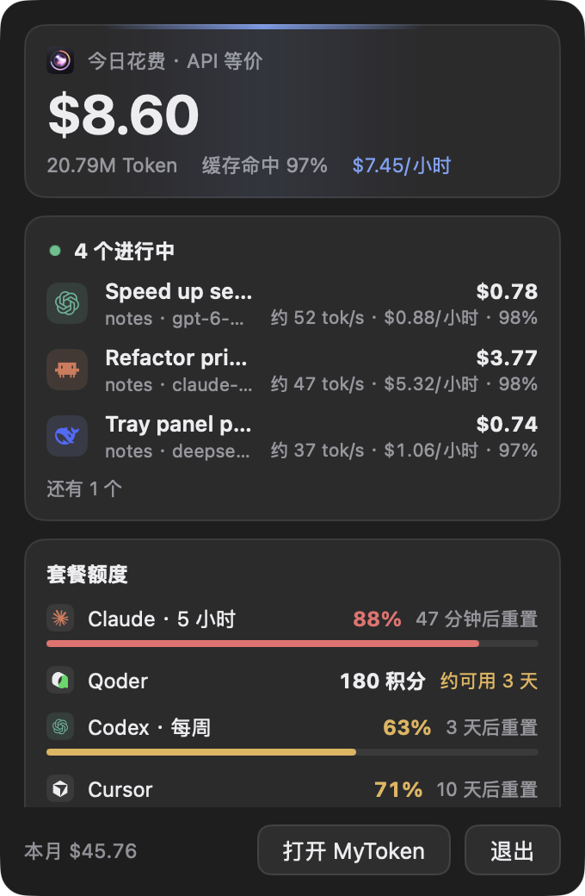
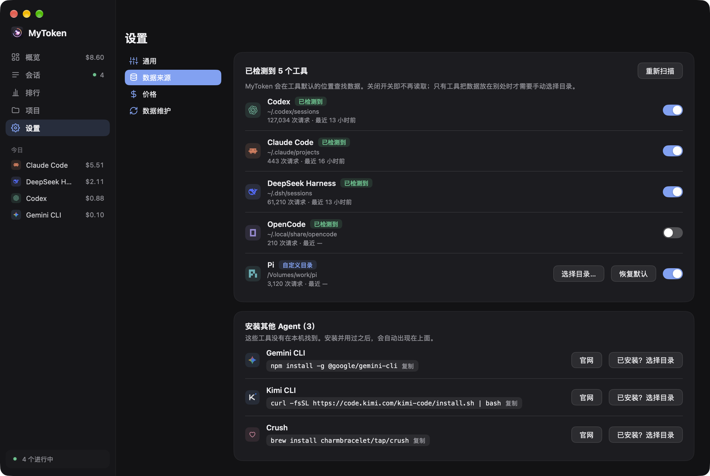

<p align="center">
  
</p>

<h1 align="center">MyToken!!!!!</h1>

<p align="center">
  <a href="https://github.com/zzstar101/mytoken/releases/latest"></a>
  <a href="https://github.com/zzstar101/mytoken/actions/workflows/ci.yml"></a>
  <a href="https://github.com/zzstar101/mytoken/releases"></a>
  
  <a href="go.mod"></a>
  <a href="LICENSE"></a>
  <a href="https://github.com/egoist/mygo"></a>
</p>

<p align="center"><b>⚡ 由 <a href="https://github.com/egoist/mygo">MyGo</a> 强力驱动！</b></p>

<p align="center"><a href="README.md">English</a> · <b>简体中文</b></p>
<p align="center"><a href="#安装">安装</a> · <a href="#界面截图">截图</a> · <a href="#支持的工具">支持的工具</a> · <a href="#套餐额度">套餐额度</a> · <a href="#计价">计价</a> · <a href="#隐私">隐私</a> · <a href="docs/CLI.md">命令行</a> · <a href="CONTRIBUTING.md">参与贡献</a></p>

**今天 AI 编程花了多少？套餐额度还剩多少？** MyToken!!!!! 读取 AI 编程工具已经写在磁盘上的会话日志，按官方
API 价格给每次请求算出等价费用，展示今日与本月花费、套餐额度和正在进行的会话 —— 在原生桌面应用、菜单栏面板
或命令行里都能看。一切都在你自己的机器上完成。

- **一个窗口里看三十二个 harness** —— Claude Code、Codex CLI、DSH、pi、Gemini CLI、opencode、Crush、
  Cline、Roo Code、Kilo Code、Claude Desktop、WorkBuddy、CodeBuddy、Hermes、Qwen Code、Kimi、
  OpenClaude、Grok、OpenClaw、Droid、Goose、Forge、Amp、Kiro、Zed、Antigravity、Codebuff、Mux、
  ZCode、MiniMax Code、MiMo Code、Step Code。
- **会话 × 供应商 × 模型** —— 五类 token 分开统计（input、output、cache read、cache write、
  reasoning），同时给出缓存命中率、按项目 / 按天的拆分，以及子代理树。
- **API 等价费用** —— 优先用 models.dev 的价格、LiteLLM 兜底，界面明确标注这是“按官方 API 价”的等价费用。
  套餐、网关或议价不同时，可以按模型自定义单价；不叠加供应商倍率，也不推断折扣。
- **花费优先** —— 今日花费大字显示，本月累计带月末预测，每日花费按工具堆叠，排行按花费。
- **套餐额度** —— Codex、Claude、Cursor、Copilot、GLM、Trae、WorkBuddy、Qoder、ZCode 以及 DeepSeek API 余额，
  自动检测并向各服务商请求。用量窗口显示已用比例和重置时间；积分余额显示剩余和还能用多少天。
- **正在进行** —— 当前运行中的会话：已花费、每小时花费、缓存命中率和估算的输出速度。
- **菜单栏** —— 图标旁显示今日花费（也可选每小时花费、缓存命中率、额度）；面板显示今日、正在进行的会话和
  所有额度。
- **命令行可脚本化** —— 不带参数运行 `mytoken` 输出今日与本月费用；`mytoken daily` 输出 ccusage 风格的每日表，
  缓存各类单独成列。
- **原生、小巧、快** —— 基于 [MyGo](https://github.com/egoist/mygo) 的原生 UI 包：没有 Electron、
  没有 WebView、不用 cgo。本机日志全量首扫只需几秒。

## 界面截图

| 概览 | 会话 |
| --- | --- |
|  |  |

| 排行 | 菜单栏面板 |
| --- | --- |
|  |  |

| 命令行 | 设置 |
| --- | --- |
|  |  |

## 安装

### macOS（磁盘映像）

从 [Releases](https://github.com/zzstar101/mytoken/releases) 下载 `mytoken-<版本>-darwin-universal.dmg`，打开后把
**MyToken!!!!!** 拖进 *应用程序*。这个 bundle 是 ad-hoc 签名、未公证的，所以第一次启动需要右键 → *打开*
（或者执行 `xattr -dr com.apple.quarantine /Applications/mytoken.app`）。应用文件名是 `mytoken.app`，
Finder 和菜单栏显示 `MyToken!!!!!`。

### Windows（安装包）

下载 `mytoken-<版本>-windows-amd64-setup.exe`（ARM 选 `-arm64-`） 并运行。安装包未签名，首次运行 SmartScreen
会要求 *更多信息* → *仍要运行*。它会安装 `mytoken.exe`、开始菜单项和卸载程序。

### Linux（安装脚本）

```sh
v=0.5.2 arch=amd64   # or arm64
curl -fLO https://github.com/zzstar101/mytoken/releases/download/v$v/mytoken-$v-linux-$arch.tar.gz
curl -fLO https://github.com/zzstar101/mytoken/releases/download/v$v/install.sh
sh install.sh mytoken-$v-linux-$arch.tar.gz
```

按用户安装，不需要 root：应用放在 `~/.local/mytoken.app`，`mytoken` 命令放在 `~/.local/bin`，并写入
应用菜单项。`sh install.sh --uninstall` 卸载并保留数据。

### Linux（Debian 包）

```sh
sudo apt install ./mytoken_<版本>_amd64.deb
```

安装到 `/opt/mytoken`，同时提供 `/usr/bin/mytoken` 命令和桌面项。依赖 GTK 3、WebKitGTK 4.1 和
libayatana-appindicator3（托盘图标）。

### 用 Go 工具链安装

```sh
go install github.com/zzstar101/mytoken@latest
```

编译出与发行包相同的二进制（含 CLI），位于 `$(go env GOPATH)/bin/mytoken`。

## 支持的工具

MyToken!!!!! 读取每个工具本来就保留的日志，只读、不回写：索引里只有数字和元数据，唯一的例外是会话标题
（首条用户消息的前 60 个字符）。套餐额度一列里的「—」表示这个工具没有可读取的套餐额度，它的用量仍然计入花费。

| 工具 | ID | 套餐额度 |
| --- | --- | --- |
| Claude Code | `claude-code` | Claude |
| Codex CLI | `codex` | ChatGPT |
| DSH — DeepSeek Harness | `dsh` | DeepSeek 余额 |
| pi / OMP / OMO-senpi | `pi` | — |
| Gemini CLI | `gemini` | — |
| opencode | `opencode` | — |
| Crush | `crush` | — |
| Cline | `cline` | — |
| Roo Code | `roo` | — |
| Kilo Code | `kilo` | — |
| Claude Desktop | `claude-desktop` | — |
| WorkBuddy | `workbuddy` | WorkBuddy |
| CodeBuddy | `codebuddy` | — |
| Hermes | `hermes` | — |
| Qwen Code | `qwen` | — |
| Kimi / Kimi Code | `kimi` | — |
| OpenClaude | `openclaude` | — |
| Grok | `grok` | — |
| OpenClaw | `openclaw` | — |
| Droid | `droid` | — |
| Goose | `goose` | — |
| Forge | `forge` | — |
| Amp | `amp` | — |
| Kiro | `kiro` | — |
| Zed | `zed` | — |
| Antigravity | `antigravity` | — |
| Codebuff | `codebuff` | — |
| Mux | `mux` | — |
| ZCode | `zcode` | — |
| MiniMax Code | `minimax-code` | — |
| MiMo Code | `mimo-code` | — |
| Step Code | `step-code` | — |

Cursor、Trae、GitHub Copilot、GLM 和 Qoder 只有额度来源，没有会话日志读取器：它们的本地格式要么不记录可用的
token（Cursor 每条消息的 `tokenCount` 恒为 0，Qoder 只有 credits），要么是加密的（Trae CN）。见
[套餐额度](#套餐额度)。

<details>
<summary>日志位置</summary>

| 工具 | ID | 日志位置 |
| --- | --- | --- |
| Claude Code | `claude-code` | `~/.claude/projects/**/*.jsonl`（`$CLAUDE_CONFIG_DIR/projects`），以及存在时的 `~/.config/claude/projects` |
| Codex CLI | `codex` | `$CODEX_HOME/sessions` 与 `$CODEX_HOME/archived_sessions`（默认 `~/.codex`） |
| DSH — DeepSeek Harness | `dsh` | `$DSH_HOME/sessions`（默认 `~/.dsh/sessions`） |
| pi / OMP / OMO-senpi | `pi` | 设置了 `$PI_HOME/sessions` 时用它；否则用 `~/.pi/agent/sessions` 并自动发现 OMP 与 OMO/senpi 的 agent 目录 |
| Gemini CLI | `gemini` | `$GEMINI_CLI_HOME/tmp`（默认 `~/.gemini/tmp`） |
| opencode | `opencode` | `$OPENCODE_DATA_HOME`，否则 `$XDG_DATA_HOME/opencode`，再否则 `~/.local/share/opencode` |
| Crush | `crush` | `$CRUSH_GLOBAL_DATA`，否则 `$XDG_DATA_HOME/crush`，再否则 `~/.local/share/crush` |
| Cline | `cline` | `…/globalStorage/saoudrizwan.claude-dev/tasks`，以及 `~/.cline/data/tasks` 与 `~/.cline/data/sessions` |
| Roo Code | `roo` | `…/globalStorage/rooveterinaryinc.roo-cline/tasks` |
| Kilo Code | `kilo` | `…/globalStorage/kilocode.kilo-code/tasks` |
| Claude Desktop | `claude-desktop` | `…/Claude/local-agent-mode-sessions` 及其 `Claude-3p` 同级目录（macOS：`~/Library/Application Support`，Windows：`%APPDATA%`），以及 Cowork 用量账本 |
| WorkBuddy | `workbuddy` | `$WORKBUDDY_HOME/projects`（默认 `~/.workbuddy/projects`） |
| CodeBuddy | `codebuddy` | `$CODEBUDDY_HOME/projects`（默认 `~/.codebuddy/projects`） |
| Hermes | `hermes` | `$HERMES_HOME`（默认 `~/.hermes`），SQLite |
| Qwen Code | `qwen` | `$QWEN_DATA_DIR/projects`（默认 `~/.qwen/projects`） |
| Kimi / Kimi Code | `kimi` | 旧版 `$KIMI_SHARE_DIR/sessions`（`~/.kimi/sessions`）加 `$KIMI_CODE_HOME/sessions`（`~/.kimi-code/sessions`） |
| OpenClaude | `openclaude` | `$CODEBURN_OPENCLAUDE_DIR/projects`，否则 `~/.openclaude/projects` |
| Grok | `grok` | `$GROK_HOME`（默认 `~/.grok`） |
| OpenClaw | `openclaw` | `~/.openclaw/agents`，以及 `~/.moltbot`、`~/.moldbot`、`~/.clawdbot` 几种拼写 |
| Droid | `droid` | `$FACTORY_DIR`（默认 `~/.factory`） |
| Goose | `goose` | `$GOOSE_PATH_ROOT/…`，否则 `~/.local/share/goose/sessions`（Windows：`%APPDATA%\Block\goose\sessions`），SQLite |
| Forge | `forge` | 默认 `~/.forge`，SQLite |
| Amp | `amp` | `$AMP_DATA_DIR`（逗号分隔），否则 `~/.local/share/amp` |
| Kiro | `kiro` | `$KIRO_HOME`（默认 `~/.kiro`），以及平台 Kiro 的 `globalStorage` agent 目录 |
| Zed | `zed` | `…/Zed/threads/threads.db`（macOS：`~/Library/Application Support`，Windows：`%LOCALAPPDATA%`，Linux：`~/.local/share/zed`），SQLite |
| Antigravity | `antigravity` | `$GEMINI_CLI_HOME/antigravity{,-cli,-ide}/conversations` 及对应的 `implicit` 目录（默认 `~/.gemini`），只读 `*.db` |
| Codebuff | `codebuff` | `$CODEBUFF_DATA_DIR`，否则 `~/.config/manicode`、`~/.config/manicode-dev`、`~/.config/manicode-staging` |
| Mux | `mux` | `$CODEBURN_MUX_DIR` 或 `$MUX_ROOT`，否则 `~/.mux`、`~/.mux-dev`、`~/.cmux` |
| ZCode | `zcode` | `$MYTOKEN_ZCODE_DIRS`，否则 `~/.zcode/cli/db/db.sqlite`，只读 SQLite |
| MiniMax Code | `minimax-code` | `$MINIMAX_DATA_DIR` / `$MAVIS_DATA_DIR`，否则 `~/.minimax/v2/sqlite/runtime-state.sqlite`（旧版 `~/.mavis`） |
| MiMo Code | `mimo-code` | `$MIMOCODE_HOME/data`；否则所有平台都用 `$XDG_DATA_HOME/mimocode` 或 `~/.local/share/mimocode`，只读 SQLite |
| Step Code | `step-code` | `$STEP_CODING_AGENT_SESSION_DIR`、`$STEP_CODING_AGENT_DIR/sessions`，否则 `~/.stepcode/agent/sessions` |

VS Code 系列扩展的 `…/globalStorage` 按平台和编辑器解析 —— 编辑器：VS Code、VS Code Insiders、Cursor、
Windsurf、VSCodium、Trae；平台：macOS 为 `~/Library/Application Support/<editor>/User/globalStorage`，
Linux 为 `~/.config/<editor>/User/globalStorage`（或 `$XDG_CONFIG_HOME/…`），Windows 为
`%APPDATA%\<editor>\User\globalStorage`。

非默认安装、容器和归档日志可以把每个读取器指向别处：

| 环境变量 | 作用 |
| --- | --- |
| `MYTOKEN_HOME` | 索引目录（所有平台） |
| `CLAUDE_CONFIG_DIR` | Claude Code 配置目录，替代 `~/.claude` |
| `CODEX_HOME` | Codex 数据目录，替代 `~/.codex` |
| `DSH_HOME` | DSH 数据目录，替代 `~/.dsh` |
| `PI_HOME`、`MYTOKEN_PI_DIRS` | pi 数据目录，或显式的 pi 兼容会话目录（路径列表） |
| `PI_CODING_AGENT_DIR`、`OMP_PROFILE`、`PI_PROFILE`、`PI_CONFIG_DIR` | `pi` 读取器复用的 OMP agent / profile 目录 |
| `OMO_CODING_AGENT_DIR`、`SENPI_CODING_AGENT_DIR` | `pi` 读取器复用的 OMO/senpi agent 目录 |
| `GEMINI_CLI_HOME`、`MYTOKEN_GEMINI_DIRS` | Gemini CLI 数据目录，或显式目录（路径列表） |
| `OPENCODE_DATA_HOME`、`MYTOKEN_OPENCODE_DIRS` | opencode 数据目录，或显式目录（路径列表） |
| `CRUSH_GLOBAL_DATA`、`MYTOKEN_CRUSH_DIRS` | Crush 数据目录，或显式目录（路径列表） |
| `CLINE_DIR`、`CLINE_DATA_DIR`、`CLINE_SESSION_DATA_DIR` | Cline 数据目录 |
| `MYTOKEN_CLINE_DIRS`、`MYTOKEN_ROO_DIRS`、`MYTOKEN_KILO_DIRS` | 显式的 Cline / Roo / Kilo 目录（路径列表） |
| `MYTOKEN_CLAUDEDESKTOP_DIRS` | 显式的 Claude Desktop 会话目录（路径列表） |
| `WORKBUDDY_HOME`、`CODEBUDDY_HOME` | WorkBuddy / CodeBuddy 主目录 |
| `HERMES_HOME` | Hermes 主目录，替代 `~/.hermes` |
| `QWEN_DATA_DIR`、`MYTOKEN_QWEN_DIRS` | Qwen Code 数据目录，或显式目录（路径列表） |
| `KIMI_SHARE_DIR`、`KIMI_CODE_HOME`、`MYTOKEN_KIMI_DIRS` | Kimi / Kimi Code 数据目录，或显式目录（路径列表） |
| `CODEBURN_OPENCLAUDE_DIR`、`MYTOKEN_OPENCLAUDE_DIRS` | OpenClaude 数据目录，或显式目录（路径列表） |
| `GROK_HOME`、`MYTOKEN_GROK_DIRS` | Grok 主目录，或显式目录（路径列表） |
| `MYTOKEN_OPENCLAW_DIRS` | 显式的 OpenClaw agent 目录（路径列表） |
| `FACTORY_DIR`、`MYTOKEN_DROID_DIRS` | Droid 主目录，或显式目录（路径列表） |
| `GOOSE_PATH_ROOT`、`MYTOKEN_GOOSE_DIRS` | Goose 数据根目录，或显式目录（路径列表） |
| `MYTOKEN_FORGE_DIRS` | 显式的 Forge 目录（路径列表） |
| `AMP_DATA_DIR`、`MYTOKEN_AMP_DIRS` | Amp 数据目录（逗号分隔），或显式目录（路径列表） |
| `KIRO_HOME`、`MYTOKEN_KIRO_DIRS` | Kiro 主目录，或显式目录（路径列表） |
| `MYTOKEN_ZED_DIRS` | 显式的 Zed threads 目录（路径列表） |
| `MYTOKEN_ANTIGRAVITY_DIRS` | 显式的 Antigravity 会话目录（路径列表） |
| `CODEBUFF_DATA_DIR`、`MYTOKEN_CODEBUFF_DIRS` | Codebuff 数据目录，或显式目录（路径列表） |
| `CODEBURN_MUX_DIR`、`MUX_ROOT`、`MYTOKEN_MUX_DIRS` | Mux 数据目录，或显式目录（路径列表） |
| `MYTOKEN_ZCODE_DIRS` | 显式的 ZCode 数据库文件或所在目录（路径列表） |
| `MINIMAX_DATA_DIR`、`MAVIS_DATA_DIR`、`MYTOKEN_MINIMAX_DIRS` | MiniMax Code 数据根目录、旧版根目录，或显式根目录（路径列表） |
| `MIMOCODE_HOME`、`MIMOCODE_DB`、`MYTOKEN_MIMO_CODE_DIRS` | MiMo Code 数据根目录、精确数据库路径，或显式根目录（路径列表） |
| `STEP_CODING_AGENT_SESSION_DIR`、`STEP_CODING_AGENT_DIR`、`MYTOKEN_STEP_CODE_DIRS` | Step Code 会话根目录、agent 根目录，或显式根目录（路径列表） |

</details>

哪些读取器已经用真实日志验证过、哪些只有 conformance 覆盖，见
[Harness 覆盖状态](docs/ARCHITECTURE.md#harness-coverage-status)。

## 套餐额度

套餐额度是 MyToken 唯一联网获取的数据，而且永远是用对应工具已经存在磁盘上的登录信息，去问服务商自己的服务器。
它不会刷新、改写或复制这些登录信息，也不会用本地用量推算额度。

| 来源 | 能看到什么 |
| --- | --- |
| Codex | ChatGPT 套餐的用量窗口，来自 Codex 的登录 |
| Claude | Claude 套餐的用量窗口，来自 Claude Code 的登录 |
| Cursor | Cursor 套餐用量，来自 Cursor 应用登录 |
| GitHub Copilot | Copilot 用量，来自 Copilot 登录 |
| GLM | Z.ai / BigModel Coding Plan 限额，来自 `Z_AI_API_KEY` 或 `BIGMODEL_API_KEY` |
| Trae（CN / Global） | Trae 套餐用量，来自应用登录 |
| WorkBuddy | WorkBuddy 套餐用量，来自应用登录 |
| Qoder | Qoder 套餐用量，来自应用登录 |
| ZCode | ZCode Start Plan 的 token 额度，来自 ZCode 应用登录 |
| DeepSeek | API 账户余额，来自 DeepSeek Harness 的凭据或 `DEEPSEEK_API_KEY` |

只有检测到某服务商的凭据时才会出现对应的额度卡片。百分比窗口显示已用比例和重置时间；积分余额显示剩余金额、
每日消耗和还能用多少天。请求失败时保留上一份成功快照并退避重试，不会拿本地数字顶替。

## 计价

- 价格优先来自 [models.dev](https://models.dev)，回退到 LiteLLM 的
  [`model_prices_and_context_window.json`](https://github.com/BerriAI/litellm)，并内置一份离线快照供首次运行使用。
  价格表会缓存在磁盘上 24 小时，有缓存时整个应用可以离线工作。
- 费用是 **API 等价**：同样的 token 按官方 API 标价会花多少。五类 token 分开计价；没有 reasoning 价格时回退到
  output 价格。
- **自定义价格与映射。** 套餐、网关或议价与标价不同时，在 *设置 → 价格* 里按模型填写每百万 token 的美元单价
  （input、output、cache read、cache write）。自己配置里发明的模型名可以映射到真实模型和可选的服务商，从而参与计价
  并合并进排行。不叠加供应商倍率，也不推断折扣。
- 缓存写入的 1 小时部分按 input 价的 2 倍计；其余部分按价格表里的 cache write 价计，价格表没有时按 input 的 1.25 倍计。
- 日志自带的费用永远优先于计算值；找不到价格的请求会明确标成 *unpriced*，而不是悄悄算成 0。
- 日志没写账户或网关时，服务商按以下顺序解析：日志本身 → cc-switch 的只读请求日志 → 请求发生时工具配置里的
  base URL → 模型名；你自己的规则优先级最高。

## 隐私

- **纯本地。** 索引、价格缓存和设置都不会离开你的机器。没有遥测、没有统计、没有崩溃上报、没有账号、没有同步。
- **完整的联网清单：** 价格表（models.dev，回退 LiteLLM）；能自我更新的构建每天一次到 github.com 检查更新
  （命令行从不检查）；以及磁盘上已经存在某工具凭据时，向该服务商自己的服务获取套餐额度。除此之外
  不联系任何服务。
- **只读读取器。** 工具日志只以只读方式打开；索引是独立的 SQLite 文件，随时可以删掉重来。
- **不存对话内容。** 只存数字和元数据，唯一的例外是会话标题：首条用户消息的前 60 个字符，只为让会话列表可读。

| 平台 | 索引目录 |
| --- | --- |
| macOS | `~/Library/Application Support/MyToken` |
| Windows | `%APPDATA%\MyToken` |
| Linux | `$XDG_DATA_HOME/mytoken`（通常是 `~/.local/share/mytoken`） |

数据库是目录里的 `mytoken.db`。用 `MYTOKEN_HOME` 可以放到别处（比如拿一份临时索引试玩）；删掉整个目录
即可重置。

## 命令行

应用二进制同时也是 CLI。在终端里不带参数运行打印只读的费用摘要；从访达、资源管理器或启动器打开时是桌面应用，
也可以用 `mytoken gui` 启动（登录项使用 `--hidden`）。完整说明见 [docs/CLI.md](docs/CLI.md)。

```sh
mytoken                                        # 今日与本月，API 等价费用
mytoken daily                                  # 每日一行，默认最近 30 天
mytoken daily --days 7 --json                  # 脚本使用
mytoken quota                                  # 从服务商服务器获取的套餐额度
mytoken scan                                   # 立刻重新索引
mytoken statusline                             # 给 shell 提示符的一行状态
mytoken doctor                                 # 只读检查索引、数据源与 schema
mytoken version
```

`summary`、`daily`、`quota`、`statusline` 与 `doctor` 以只读方式打开索引：不迁移、不重算价格、不写入。
升级后运行一次 `mytoken scan` 完成迁移与重新计价。`mytoken help` 会列出所有命令，每个参数的含义见
[docs/CLI.md](docs/CLI.md)。

## 参与贡献

缺陷修复、新 harness、新额度来源和翻译都欢迎直接提 PR；新功能或界面改动请先开 issue 讨论。
[CONTRIBUTING.md](CONTRIBUTING.md) 里有开发环境、测试、conformance 套件，以及新增 harness 和额度来源的清单。

## 致谢

- [tokscale](https://github.com/junhoyeo/tokscale) 记录了许多 MyToken 遵循的解析规则；没有复制代码。
- [codeburn](https://github.com/nerv-builds/codeburn) 是多个读取器的来源（Qwen、Kimi、OpenClaude、
  Claude Desktop、Grok、OpenClaw、Droid、Goose、Forge）——见 [THIRD_PARTY_NOTICES](THIRD_PARTY_NOTICES)。
- [MyGo](https://github.com/egoist/mygo) 提供原生 UI 包。
- [models.dev](https://models.dev) 与 [LiteLLM](https://github.com/BerriAI/litellm) 提供价格表。
- [cc-switch](https://github.com/farion1231/cc-switch) 定义了价格导入格式，以及归因使用的服务商请求日志。

## 免责声明

MyToken!!!!! 是对乐队 MyGO!!!!! 的非官方致敬。名称、配色和装饰是善意的引用；本项目与乐队及其权利方没有关联，
也未获其背书，不包含任何官方美术资源。所有商标归各自所有者。

## 许可证

MIT © 2026 zzstar101。见 [LICENSE](LICENSE)。
