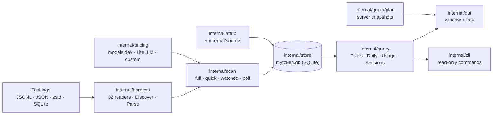

# Architecture

MyToken!!!!! is a local, read-only index of what AI coding tools spent. It never talks to a
tool's API to learn usage: every number comes from logs the tool already wrote, except plan quota,
which is fetched from the provider's own server with the login the tool already stored.

The data layer is deliberately small and linear:



Two rules keep the design honest:

- **The index is rebuildable.** Deleting it loses no source data; a full rescan reconstructs it.
  History is append-only: a tool rotating its logs away does not delete rows already indexed.
- **Nothing is invented.** Unknown models are *unpriced*, unknown providers are *inferred* or
  `unknown`, and an absent cost stays `nil`. A guessed number is worse than a visible gap.

## Data model

`internal/model/model.go` holds the shared types; changing an exported signature needs lead
approval.

| Type | Carries |
| --- | --- |
| `Harness` | A tool id such as `claude-code`, `codex`, `dsh`. `DisplayName()` and `Known()` come from the registry in the same file. |
| `Tokens` | `Input`, `Output`, `CacheRead`, `CacheWrite`, `CacheWrite1h`, `Reasoning` — all `int64`. `Total()` adds all five classes; the 1-hour cache write is a *subset* of `CacheWrite`, so it is not added twice. |
| `UsageEvent` | `Harness`, `DedupKey`, `SessionID`, `ParentID`, `ProjectPath`, UTC `Timestamp`, `Model`, `Provider`, `BaseURL`, `Tokens`, optional `CostUSD *float64`, `RequestID`, `Boundary`, optional `Bill`, `GitBranch`. |
| `SessionMeta` | `Harness`, `SessionID`, `ParentID`, `Title` (at most 60 runes), `Project`, `StartedAt`, `UpdatedAt`. |
| `Boundary` | `compact`, `clear` or `resume`: an explicit context replacement recorded by some tools; never inferred. |
| `Bill` | A native charge (`Amount`, `Unit`) that is displayed as-is and never converted to USD. |
| `AttribSource` | `log`, `cc-switch`, `config-timeline`, `inferred`, `user-rule`. |

`GitBranch` is the branch named *inside the log* (Claude's top-level `gitBranch`, Codex's
`session_meta.payload.git.branch`), never a branch read from the current working tree.

## Parser contract

`internal/harness/harness.go` defines the contract every tool reader implements:

```go
type Parser interface {
    Harness() model.Harness
    Roots() []string
    Discover(ctx context.Context) ([]Source, error)
    Parse(ctx context.Context, src Source, cur Cursor) (Batch, error)
}
```

- `Source{Path, Kind}` where `Kind` is `jsonl`, `json`, `jsonl.zstd` or `sqlite`.
- `Cursor{Offset, Size, ModTime, Fingerprint, Extra}` is persisted per `(harness, path)` by the
  store. `Offset` is the byte position after the last *complete* record; `Fingerprint` is a SHA-1
  of the first 4 KiB; `Extra` is parser-private state such as a SQLite rowid. `Source` and
  `Cursor` are in the same file.
- `Batch{Events, Sessions, Next}` returns both the facts and the session metadata they imply.
- `Discover` on a missing root returns **no sources and no error**: not installed is a normal
  state. `Parse` must consume only complete records and must return `Batch{Next: cur}` when
  nothing new arrived, so the scanner can skip the write.

Roots are built with `harness.Rooted` / `harness.WithRoots` (`internal/harness/detect.go`). A
parser reports its built-in, environment and explicit roots through `RootOrigin`
(`builtin`, `env`, `explicit`); the GUI uses `Detect` and `ValidateRoot` to show a detected /
not-detected / invalid-directory state without walking the log tree. `ValidateRoot` calls
`WithRoots(dir).Discover` so a picked folder is accepted exactly when the reader can read it.

Parsers register themselves from `init()` with `harness.Register`, and the application imports
every package for its side effect in `internal/app/app.go`. **A parser without that blank import
is invisible to `doctor`, scanning and the UI even though its own tests pass.** `harness.All()` is
sorted; `harness.Get(id)` is the lookup.

### Conformance suite

`internal/harness/harnesstest` is the shared suite. Each parser package has a
`conformance_test.go` that runs it against a redacted fixture:

```sh
go test ./internal/harness/<name> -run Conformance -count=1
go test ./internal/harness/<name> -run Conformance -update   # rewrite golden.json
```

The suite checks:

- **Golden** — `Discover` + `Parse` output is byte-identical to `golden.json`, and the fixture
  yields at least one source and one event.
- **Incremental** — growing the fixture and re-reading with the previous cursor equals a one-shot
  read; the fixture's `Grow` step supplies the growth when the format is not append-only.
- **Cursor stability** — an unchanged source returns no events and `Next == cur`.
- **Idempotence** — two reads from an empty cursor produce the same `DedupKey` set, with no
  duplicates inside a run.
- **Privacy** — fixture text marked with `harnesstest.SentinelText` appears neither in the parsed
  output nor in the golden file. The sentinel belongs in assistant/tool/reasoning text, never in
  the first user message (that would legitimately become the title).
- **Missing root** — `Discover` returns zero sources and `nil`.

Fixtures stay small but should cover two sessions (parent/child where the format supports it), two
models, cache read and write, reasoning, a record without usage, a non-usage record, and a fixed
UTC timestamp. The fixture root passed to `Case.New(root)` must be exactly the directory
`Discover` reads.

## Token normalization

The five token classes are not interchangeable, and each tool reports them differently. The
reader normalizes into `model.Tokens`; everything downstream (pricing, rollups, the UI) assumes
this normalized shape.

- **Anthropic-shaped logs** (Claude Code, Claude Desktop, Zed, OpenClaude, …):
  `usage.input_tokens` already excludes cache traffic, so it becomes `Input` unchanged.
  `cache_creation_input_tokens` becomes `CacheWrite`; `cache_read_input_tokens` becomes
  `CacheRead`. `output_tokens` already includes reasoning, so reasoning is never added again.
- **1-hour cache writes.** `cache_creation.ephemeral_1h_input_tokens` is a *subset* of
  `CacheWrite`. It is stored in `CacheWrite1h` while `CacheWrite` keeps the total. The 5-minute
  tier is `CacheWrite - CacheWrite1h`. Only parsers that see the nested breakdown populate
  `CacheWrite1h`; flat logs leave it zero, which means "all at the 5-minute rate".
- **Cumulative counters** (Crush and other session-summary logs) are diffed against the previous
  record. A counter that goes backwards lowers the baseline and never produces a negative event.
- **Prompt totals that include cache** (Gemini CLI, Qwen): the cached count is split out of the
  prompt total into `CacheRead` instead of being counted as fresh input.
- **Streaming duplicates** are merged by maximum, not summed. The same request appearing twice in
  a log must not double count.
- **Reasoning** is its own class and is priced at the output rate unless the catalog has an
  explicit reasoning price.

### Measured generation speed

`DecodeMS` is not a token class; it is the one thing about *time* a log can state. A harness that
journals its own token stream (DSH writes `data.stream` into every settled message, with a
millisecond time on each record) knows when the first output token arrived and when the message
settled. The reader records that window, and the live view divides output tokens by it instead of
estimating speed from the gaps between requests. A log that does not time its stream leaves the
column zero, which means *not measured*, and the view falls back to repairing request gaps. No
reader derives a window from timestamps: a guess must never outrank a measurement. A parser that
starts reporting windows raises its `ParserVersion`, so an older index re-ingests its rows once.

The single free-text field is the session title: `harness.Title` collapses whitespace and
truncates to 60 runes. It comes only from the first user message, and the store keeps the first
non-empty title it sees.

## Deduplication and privacy

`DedupKey` must be stable across re-reads, appends and whole-file rewrites, because the scanner
re-reads a source whenever its fingerprint changes. Prefer an id from the log (a message id plus
request id, a compaction id, an API request sequence); otherwise derive a key from the session
plus a sequence that the tool itself records. **Never use a line number, byte offset or timestamp
alone** — an inserted line would change every following key.

The privacy boundary is enforced at parse time, before anything reaches the store:

| Allowed | Never stored |
| --- | --- |
| Token counts, model and provider names, timestamps | User or assistant message text |
| Session ids and parent links | Tool call arguments or output |
| Project path, git branch | File contents, system prompts, reasoning text |
| The first user message truncated to 60 runes | API keys, OAuth tokens, cookies, credentials |

Readers open a tool's logs read-only and keep their cursors in MyToken's own database. SQLite
sources are opened `query_only` and must not create a WAL, journal, migration or sidecar file. A
reader never refreshes, rewrites or copies a tool's credentials.

### Cost semantics

A cost may come from the log itself or from the price catalog:

- `CostUSD == nil` means the log reported no cost; the computed catalog price applies.
- A non-nil zero or positive value is a reported cost and wins over the catalog. Zero is
  authoritative only where the upstream format distinguishes "reported zero" from "missing"
  (MiniMax writes `NULL` when it has nothing); a format whose zero means "unknown" (OpenCode and
  MiMo `MessageV2.cost`) is normalized to `nil`.
- When no class of the price is known, the request is **unpriced**: its tokens and request count
  still contribute to totals, but its cost is zero and the UI marks it. It is not silently free.

## Storage

`internal/store` owns the SQLite index. Configuration is in `internal/paths/paths.go`: macOS
`~/Library/Application Support/MyToken`, Windows `%APPDATA%\MyToken`, Linux
`$XDG_DATA_HOME/mytoken` (or `~/.local/share/mytoken`), always overridable with `MYTOKEN_HOME`.
The database is `mytoken.db`.

- `store.Open` serializes writes through one connection (`SetMaxOpenConns(1)`), sets
  `journal_mode=WAL`, `synchronous=NORMAL`, `busy_timeout=5000`, `temp_store=MEMORY`, and runs the
  migrations. `store.OpenReadOnly` / `snapshot` open the same file read-only with
  `query_only(1)`; the CLI uses this and therefore never migrates or reprices.
- `Store.ReadDB()` is a lazily opened, read-only pool over the same WAL file. The GUI reads a
  consistent snapshot through it while the scanner's writer commits.
- **Facts vs dimensions.** `event_data` stores one row per request (`dedup_key`, timestamp, five
  token classes, the measured `decode_ms` window, nullable `log_cost`, computed `cost`, `priced`,
  request/boundary/bill columns).
  `event_dimensions` is a string dictionary (harness, session, parent, project, raw project, model,
  provider, base URL, resolved provider, attrib); `event_data.dimension_id` references it. `events`
  is a compatibility **view** joining the two, with `INSTEAD OF` triggers so older queries and
  migrations still work.
- **Rollups.** `daily_usage` and `provider_daily` hold day-bucketed sums by day, harness, session,
  resolved provider, raw model, project and attrib, maintained by triggers on `event_data`.
  Deletes flow through the same triggers, which is what makes a scoped parser reset lossless.
  `provider_daily` adds the endpoint identity used by provider grouping.
- **Metadata tables.** `sessions` (title, project, parent, timestamps), `cursors` (per source),
  `event_branches` (the per-request git branch, deliberately not a rollup dimension),
  `provider_configs` (the attribution timeline), and `settings` (key/value).
- **Day boundary.** Bucketing is by `time.Local`. The app persists a fixed IANA reporting zone as
  `stats_timezone` and applies it to `time.Local`; the rollup key `daily_timezone` is a fingerprint
  of that zone's UTC offsets across several years, not a zone name. When the fingerprint changes,
  `EnsureLocalDays` rebuilds only the derived rollups. A CLI `--timezone` override applies to that
  invocation only and falls back to fact scans, so it never rewrites the index.
- **Migrations** run in one transaction after a pre-migration backup and integrity check
  (`backup.go`). A `historyDigest` of per-request token totals is compared before and after, then
  `VACUUM` reclaims space (`cleanup.go`). The 0.5 cleanup dropped the relay, cache-ledger, budget
  and instance *features* and added the 1-hour cache-write column. The internal `instance_id`
  column survives as a migration-risk hedge (every row uses `default`) and is scheduled for
  removal.
- Removed events are never left half-deleted: `ResetHarness` deletes scoped facts, lets the
  triggers update the rollups, drops now-unreferenced dimensions and sessions, and records the new
  parser version in the same transaction.

## Scanning

`internal/scan/scanner.go` turns parsers into index updates. A scan has four modes:

| Mode | Discovery | Parse |
| --- | --- | --- |
| `scanFull` | every parser, every root | every source |
| `scanQuickAll` | every parser, every root | only sources whose stat changed |
| `scanWatched` | only parsers whose roots a watched change touched; reuses the previous discovery | only the hinted sources |
| `scanPoll` | none | known sources, no tree walk |

`Run` starts with a full scan, then watches roots with fsnotify. Watched changes trigger
`scanWatched` (or `scanQuickAll` when too many hints arrive); a 30-second poll covers sources the
watcher could not take, and a 3-minute quick and 10-minute full scan reconcile everything. The
watcher never registers more than `maxWatchDirs = 2048` directories, spends at most
`newDirBudget = 32` on newly created subdirectories, and caps pending hints at 256 — each watched
directory costs a file descriptor on macOS, and the periodic scan is the safety net. Changes are
debounced for 250 ms with a 750 ms minimum gap.

The scanner caches the last `Discover` result per harness (and instance), but a `scanQuickAll`
always re-walks the tree. Each source's size, modification time and (for SQLite) WAL stamp are
compared before parsing, so an idle scan parses nothing. `internal/ingestrate` derives the live
event rate shown in the UI from the newest timestamps.

### Parser versions and lossless resets

Parsing logic changes; stored events must then be re-read, or the index would keep rows written by
the old parser forever. A parser that changes its output implements `harness.Versioned`:

```go
func (p *Parser) ParserVersion() int { return 2 }
```

The scanner compares it with the `harness.<id>.parser_version` setting. On a raise, only the
scans that visit every harness (`scanFull`, `scanQuickAll`) may reset one, because they can re-read
it in the same pass. A parser that raises its version must also implement `harness.SourceSessions`
so the reset can name the rows to replace. `store.ResetHarness` then deletes only the current
sources' events and sessions, records the new version, and lets the ordinary scan read them
again. A log the tool has rotated away is **not** deleted: it is the only copy of that history.
This is why a version bump requires `SourceSessions` — the scanner refuses an unscoped destructive
reset.

## Query

`internal/query` is the read API shared by the GUI and the CLI. It reads facts through the
read-only pool and applies the timezone, alias and price rules at read time.

- `Range{From, To}` is half-open; `Filter` narrows by harness, provider, model, project and
  endpoint. Empty filters mean "everything".
- `Totals`, `Daily`, `Hourly`, `ByProvider`, `ByModel`, `ByProject`, `ByHarness`, `Usage`,
  `HourlyUsage`, `Sessions` and `Session` are the public shapes. `Daily` and `Hourly` zero-fill
  every bucket between the range ends (or the data's own ends) and step by calendar day/hour, so
  DST transitions cannot shift a bucket.
- `Sessions` ranks and paginates **root** sessions; a parent's aggregate includes its descendants.
  `Session` returns that session's own events and its direct children separately.
- `CostSource` is `log`, `estimate` or `unpriced`; a bucket keeps `Unpriced` counts so the UI can
  say "3 unpriced models" instead of showing a misleading zero.
- `Subscribe` notifies readers at most once a second after a write, which is what makes the GUI
  refresh cheap.

## Pricing

`internal/pricing` keeps a price per model and token class, in USD per million tokens:

- The primary source is [models.dev](https://models.dev), with LiteLLM's
  `model_prices_and_context_window.json` as fallback. A bundled `snapshot.json` makes the first run
  and offline use work. The fetched table is cached in the data directory for 24 hours.
- Input, output, cache read and cache write are priced separately. A missing reasoning price falls
  back to output. A missing cache-write price falls back to 1.25 × input.
- 1-hour cache writes cost 2 × input; the 5-minute part costs the catalog's cache-write rate (or
  1.25 × input). `CacheWrite1h` is subtracted from `CacheWrite` before the 5-minute rate applies.
- User price rules are layered over the catalog, class by class (`internal/query/settings.go`):
  provider + model beats model beats provider beats catalog, and the latest rule whose `From` is
  at or before the request wins. Rules never override a cost the log reported.
- A logged cost always wins. A model with no price in any layer is unpriced, not zero.
- Model aliases are applied at query time to both pricing and display, so renaming a model does
  not require rewriting history. Custom prices are per model and per class; there are no provider
  multipliers or discounts.

## Attribution

Logs often do not name the account or gateway. `internal/attrib` resolves a provider without
reading conversation content, in this order:

1. **User rules** (`user-rule`) — settings `attribution.rules`, optional harness/model/time scope.
2. **The log itself** (`log`) — a specific provider name, or a generic name resolved by the
   recorded base URL's host.
3. **cc-switch's request log** (`cc-switch`) — read-only `~/.cc-switch/cc-switch.db`, matched by
   app type, model and token counts within ±120 s (`internal/source/ccswitch.go`).
4. **The config timeline** (`config-timeline`) — the base URL in `~/.claude/settings.json` or
   `~/.codex/config.toml` at the request's timestamp, tracked in `provider_configs`
   (`internal/source/harnessconfig.go`).
5. **The model name** (`inferred`) — `claude-*` → Anthropic, `gpt-*`/`o*` → OpenAI, `gemini-*` →
   Google, `deepseek-*` → DeepSeek, and the mappings in `attrib.Infer`.

A source that is missing or unreadable is skipped, never fatal. Sources are read-only and are never
allowed to copy credentials into the index. The resolved provider and its `AttribSource` are
stored per event, so the UI can show *why* it believes a request used a gateway.

## Plan quotas

Plan quota is the one feature that talks to a provider's server. `internal/quota/plan` defines the
contract:

```go
type Provider interface {
    ID() string
    DisplayName() string
    Detect(ctx context.Context) bool       // cheap, local, no network
    Fetch(ctx context.Context) (Snapshot, error)
}
```

- `Snapshot{Provider, Plan, Windows, Daily, FetchedAt, Source}`. `Source` must be `api`; a quota
  derived from local logs is invalid by construction (`Validate` rejects it).
- `Window` is either a percentage window (`UsedPercent`, `Used`, `Limit`, `ResetsAt`) or a credit
  balance (`Balance`, `Remaining`, `ExpiresAt`). Balance windows are never rendered as
  percentages; `Remaining` is authoritative. `Daily` keeps at most 14 days for runway estimates.
- The service polls every 5 minutes (minimum 30 s), with a 20 s fetch timeout. Failures back off
  exponentially (1 → 30 minutes, honoring `Retry-After` up to an hour). Only the last good
  snapshot and the status are persisted, under `quota.plan.<id>`; `Offline` reads the cache
  without fetching.
- `internal/quota/providers/providers.go` wires Codex, Claude Code, Cursor, GitHub Copilot, GLM,
  DeepSeek, Trae (CN and Global), WorkBuddy (and its AI variant), Qoder and ZCode. Codex reads its
  existing `$CODEX_HOME/auth.json` (default `~/.codex`) and calls the ChatGPT backend usage endpoint;
  DeepSeek reads its Harness credential or `DEEPSEEK_API_KEY` and calls the balance endpoint. ZCode
  unseals the token the ZCode app stores in `~/.zcode/v2/credentials.json` and calls the ZCode
  gateway's plan-balance endpoint. No provider refreshes or rewrites a stored login.
- The UI only shows a quota card for a provider whose credential was detected. There is no
  separate consent step, and no credential is copied into the index.

## App wiring

- `internal/app/app.go` opens the store, builds the resolver, pricing catalog, scanner, query
  service and quota service, and exposes `Open` (network allowed) and `OpenLocal` (demo: no price
  download, no quota fetches). `App.Close` stops the scanner and quota service.
- `main.go` installs the system proxy before any socket, then either runs a CLI command, or starts
  the GUI. A bare invocation from a terminal is the read-only summary; from Finder, Explorer or a
  launcher it is the app (`mytoken gui`, login item `--hidden`). It takes a single-instance lock
  unless `MYTOKEN_HOME` points at a separate index, and forwards a second launch's request to the
  running window. It installs the native updater plugin and serves `MYTOKEN_PPROF` when set.
  `GOMEMLIMIT=64MiB` and `GOGC=50` are defaults only.
- `main_gui.go` adapts the app's services to the narrow interfaces `internal/gui` declares:
  `Query`, `Quotas`, `Sources`, `Prices`, `Maint`, `Prefs`, `Version` and `Export`. Quota
  snapshots are converted to UI windows here; a non-balance window whose reset time has passed is
  cleared (its percentage resets to zero) instead of being shown as still exhausted.
- The tray and the main window share one `gui.App`. The main window is destroyed when closed to
  return its GPU surfaces and glyph atlases (~90 MB) and rebuilt on demand; the frameless tray
  panel lives all along. On Windows the tray menu opens on right-click; on macOS it is lent to the
  status item only for the right-click menu.
- The CLI (`internal/cli`) is read-only except for `mytoken scan`: `summary`, `daily`, `quota`,
  `statusline` and `doctor` open the index read-only and report an upgrade-required index instead
  of migrating it.

## Performance budgets

Measured on the maintainer's real-data copy (~255K events). These are hard budgets, not
aspirations:

| Budget | Target | How to measure |
| --- | --- | --- |
| Full scan | ≤ 15 s | copy the index, then `MYTOKEN_HOME=<copy> go run . scan`; or `MYTOKEN_REAL_PERF=1 go test ./internal/scan -run TestCopiedDatabaseScanPerformance -v` against a copy |
| Incremental scan | ≤ 25 ms | append one event to a source and time the resulting watched scan; `go test ./internal/scan -run '^$' -bench BenchmarkIncrementalAppend -benchtime 200x` |
| Idle background CPU | < 0.5 % of a core | leave the app idle for a minute and read it in Activity Monitor / `ps -o %cpu` |
| File descriptors | < 150 | `lsof -p <pid> | wc -l` while idle and while scanning |
| One UI refresh | < 25 ms | time a data reload with `MYTOKEN_PPROF` or the GUI's own timing; the load runs off the UI thread |
| One frame | ≤ 8 ms | `MYGO_FRAME_STATS=1` while switching pages, hovering and scrolling |
| CLI read-only command | < 150 ms | `time ./mytoken summary` with a warm index |

Design choices that protect the budgets: append-only parsing with a cursor, a stat check before
every parse, a capped fsnotify plan with a poll fallback, deferred index creation during an empty
first scan, one writer with a read-only pool for the UI, rollups for day queries, virtual lists,
and paint-only animations (`p.AnimatePose` / `ContentTransition` / `p.Now()`) instead of state
changes per frame. Data loads use the job pattern in `internal/gui/app.go` and post back to the UI
thread.

The query gate is separate: `MYTOKEN_STRICT_PERF=1 go test ./internal/query -run
TestQueryPerformanceBudget -v -count=1` requires each query over a 200K-event fixture to stay under
100 ms and 50 MiB of allocations. CI runs the 200K benchmarks on every platform. Never run a
performance rescan against the normal app data directory; copy the index to a temporary
`MYTOKEN_HOME` first.

## Harness coverage status

Each of the 32 registered parsers has a conformance fixture. Passing synthetic conformance is
**not** the same as validation against real logs:

- **Protocol-validated against upstream plus synthetic fixtures, without a committed anonymized
  real install:** ZCode, MiniMax Code, MiMo Code, Step Code, Kimi Code and the OMP/OMO
  compatibility paths.
- **Conformance-only (no real-world fixture yet):** Amp, Kiro, Zed, Antigravity, Codebuff, Mux,
  Hermes and OpenClaw.
- **No harness is possible from local logs for Cursor, Trae and Qoder.** Cursor v3 reports
  per-message `tokenCount` as `{0,0}` (and `composerData.usageData` is empty), so a parser could
  only emit zeros or a character estimate. The Trae CN database is SQLCipher 4 encrypted without a
  usable read-only key. Qoder transcripts carry `credits` rather than tokens; credits cannot be
  converted to USD. All three have **quota** support instead, which uses the provider's own API.
- **VS Code-family paths.** `…/globalStorage` is resolved for VS Code, Insiders, Cursor, Windsurf,
  VSCodium and Trae on macOS, Linux and Windows; the Cline/Roo/Kilo readers use the same
  resolution.

New parsers should follow the package layout and conformance rules above; new quota providers
should implement `plan.Provider`, always fetch from the server and never derive a value from local
usage. [CONTRIBUTING.md](../CONTRIBUTING.md) has the checklists.
